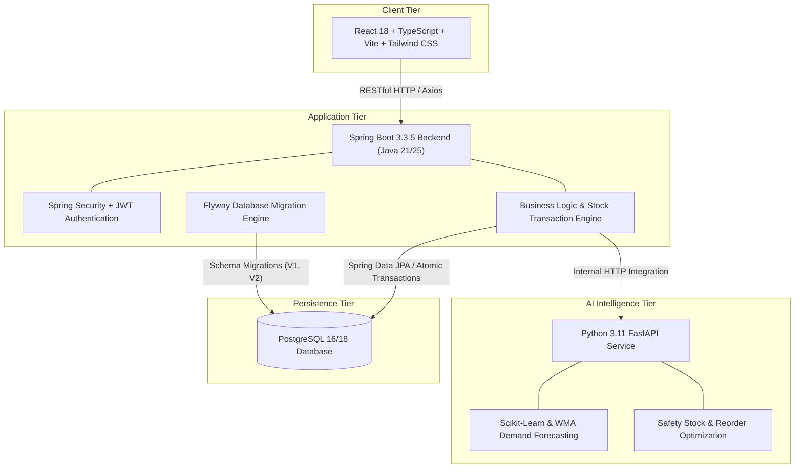

# Smart Inventory Management System
## AI-Powered Inventory & Stock Optimization Platform

An enterprise-grade, multi-tier Smart Inventory Management System engineered with Java Spring Boot, React with TypeScript, PostgreSQL, and a Python FastAPI AI Forecasting Engine.

---

## 1. System Architecture



---

## 2. Technology Stack

- **Backend:** Java 21 / 25, Spring Boot 3.3.5, Spring Security, Spring Data JPA, Hibernate, JWT (`jjwt 0.12.6`), Bean Validation, Maven, Springdoc OpenAPI 2.6.0 (Swagger UI).
- **Frontend:** React 18, TypeScript, Vite, Tailwind CSS, Lucide React, Recharts, React Router v6, Axios.
- **Database:** PostgreSQL 16 / 18, Flyway database schema migrations (`V1__init_schema.sql`, `V2__seed_initial_data.sql`).
- **AI/ML Service:** Python 3.11, FastAPI, Pandas, NumPy, Scikit-learn, Joblib.
- **DevOps & QA:** Docker, Docker Compose, JUnit 5, Mockito, Pytest, Vitest, React Testing Library.

---

## 3. Core Modules & Business Capabilities

1. **Authentication & Authorization (RBAC):**
   - User registration and login with JWT bearer tokens.
   - BCrypt password encryption.
   - Three distinct operational roles: `ROLE_ADMIN`, `ROLE_INVENTORY_MANAGER`, `ROLE_STAFF`.
2. **Executive Dashboard:**
   - Real-time KPIs: Total Products, Suppliers, Stock Quantity, Valuation, Low Stock, Stock-In Today, Stock-Out Today.
   - Monthly Stock-In vs Stock-Out movement bar chart.
   - Inventory valuation by category distribution pie chart.
   - Recent activity ledger feed and active stock warnings.
3. **Product Management:**
   - Complete CRUD with unique SKU enforcement, negative price prevention, and stock boundary configuration.
   - Filter by category, vendor, and stock health status (HEALTHY, LOW, CRITICAL, OUT_OF_STOCK).
   - Deletion validation protecting transaction integrity.
4. **Supplier Management:**
   - Vendor master profiles, contact persons, phone/email, address, and GST numbers.
   - Direct inspection of all products supplied by a specific vendor.
5. **Stock-In Management (Receiving):**
   - Atomically increments physical product inventory.
   - Attributes batch receipts to suppliers and records invoice/reference numbers.
   - Automatically settles or clears active low-stock alerts if inventory reaches healthy levels.
6. **Stock-Out Management (Dispensing):**
   - Categorized dispensing reasons: `SALE`, `DAMAGED`, `EXPIRED`, `INTERNAL_USAGE`, `OTHER`.
   - Prevents negative inventory by validating available stock before committing.
   - Automatically raises low-stock or critical alerts when safety thresholds are breached.
7. **Auditable Transaction History:**
   - Immutable chronological ledger capturing previous stock, updated stock, user, and timestamps.
   - Export full transaction history as CSV.
8. **Low-Stock Alerts & Notification Lifecycle:**
   - Real-time detection of `OUT_OF_STOCK`, `CRITICAL_STOCK`, and `LOW_STOCK` states.
   - Deduplication prevents repetitive alerts for unresolved stock conditions.
   - Status transitions: `ACTIVE` &rarr; `ACKNOWLEDGED` &rarr; `RESOLVED`.
9. **AI Demand Forecasting & Optimization:**
   - **Stock-Out Prediction:** Calculates daily demand rate and predicts exact exhaustion date and runway days.
   - **Intelligent Reorder Quantity:** Combines lead-time demand with safety stock ($Z \times \sigma \times \sqrt{L}$) at a 95% service level.
   - **Multi-Horizon Forecasting:** Interactive 7-day, 15-day, and 30-day projected demand curves.
   - **Inventory Risk Classification:** Automatic labeling into Healthy, Low Risk, Medium Risk, High Risk, or Critical.
   - **Graceful Fallback:** If the Python service is offline, the backend executes an internal Java baseline heuristic to ensure zero downtime.
10. **Reports & Valuation Analytics:**
    - Financial valuation breakdown across product categories.
    - Exportable CSV reports for inventory snapshots and transaction audits.
11. **User Management & Settings:**
    - Admin interface for account status toggling (active/deactivated) and role assignments.
    - System health monitoring for backend, database, and AI service microservices.

---

## 4. Quick Start Guide

### Option 1: Docker Compose (Recommended)

Start the entire platform (PostgreSQL, Spring Boot Backend, Python AI Service, React Frontend) in one command:

```bash
docker compose up --build
```

**Service Endpoints:**
- **Web Frontend:** [http://localhost:3000](http://localhost:3000)
- **Spring Boot Backend & Swagger UI:** [http://localhost:8080/swagger-ui.html](http://localhost:8080/swagger-ui.html)
- **Python FastAPI Docs:** [http://localhost:8000/docs](http://localhost:8000/docs)
- **PostgreSQL Database:** `localhost:5432` (User: `postgres`, Password: `postgres`, DB: `inventory_db`)

---

### Option 2: Local Development Setup

#### 1. Backend (Spring Boot)
Ensure Java 21 or 25 and Maven are installed:
```powershell
cd backend
mvn clean spring-boot:run
```

#### 2. AI Forecasting Service (Python FastAPI)
Ensure Python 3.11+ is installed:
```powershell
cd ai-service
pip install -r requirements.txt
python main.py
```

#### 3. Frontend (React Vite)
Ensure Node.js 18+ is installed:
```powershell
cd frontend
npm install
npm run dev
```
Open [http://localhost:5173](http://localhost:5173) in your browser.

---

## 5. Evaluation Credentials

The application is pre-seeded with sample inventory data, realistic transactions, and 3 evaluation accounts:

| Role | Username | Password | Purpose |
| :--- | :--- | :--- | :--- |
| **Administrator** | `admin` | `Admin@123` | Full privileges: User management, delete operations, configuration |
| **Inventory Manager** | `manager` | `Manager@123` | Operational lead: Products, suppliers, stock-in receiving, alerts |
| **Operations Staff** | `staff` | `Staff@123` | Warehouse operator: Stock-out dispensing, viewing catalog and ledger |

*(On the Login screen, click the **1-Click Demo Profiles** buttons to instantly fill credentials).*

---

## 6. Testing & Quality Assurance

### Run Backend Unit & Integration Tests:
```powershell
cd backend
mvn test
```
*Result: 10/10 tests passed (AuthService, ProductService, StockService, DashboardService).*

### Run AI Forecasting Engine Tests:
```powershell
cd ai-service
pytest tests
```
*Result: 10/10 tests passed (Predictions, edge cases, zero stock, reorders, forecasting).*

### Run Frontend Vitest & React Testing Library Tests:
```powershell
cd frontend
npm test
```
*Result: 2/2 tests passed.*

### Run Production Builds:
```powershell
# Frontend production build
cd frontend
npm run build

# Backend package build
cd backend
mvn clean package -DskipTests
```

---

## 7. Database Entity Relationship Overview

- `users` (id, username, email, password, full_name, role_id, is_active, created_at, updated_at)
- `roles` (id, name, description)
- `categories` (id, name, description, created_at)
- `suppliers` (id, supplier_name, company_name, email, phone, address, contact_person, gst_number, status, created_at, updated_at)
- `products` (id, name, sku [unique], description, category_id, unit, purchase_price, selling_price, current_stock, minimum_stock_level, maximum_stock_level, reorder_level, supplier_id, version, created_at, updated_at)
- `stock_transactions` (id, product_id, supplier_id, transaction_type, quantity, previous_stock, updated_stock, unit_price, reference_number, remarks, performed_by_user_id, transaction_date, created_at)
- `inventory_alerts` (id, product_id, alert_type, current_stock, threshold_stock, status, message, resolved_at, created_at, updated_at)
- `product_demand_history` (id, product_id, demand_date, quantity_demanded, transaction_count, created_at)
- `audit_logs` (id, action, entity_name, entity_id, performed_by, details, ip_address, created_at)

